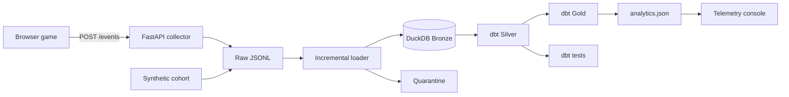

# Packet Panic

**A playable retro arcade game backed by a tested gameplay telemetry pipeline.**

[Play the live demo](https://packet-panic-telemetry.byww6j8ky8.chatgpt.site)

Packet Panic controls the full data lifecycle: the game produces versioned behavioral events, an ingestion service validates them, an incremental loader preserves the raw batch, dbt reconstructs player sessions in DuckDB, and the resulting warehouse metrics power the analytics interface.

The product question is intentionally understandable without data-engineering knowledge:

> Where do players struggle, quit and improve—and can we trust the events behind that conclusion?

## What is real

The dashboard baseline is not hardcoded. It is generated from a deterministic cohort of **120 sessions and 7,514 events**, processed through the same pipeline included in this repository. The current snapshot finds the largest progression drop between Waves 3 and 4.

- The event collector enforces a versioned Pydantic contract.
- Bronze storage is append-only JSONL plus raw DuckDB tables.
- Silver dbt models normalize and deduplicate events.
- Gold models produce session facts, funnels and gameplay KPIs.
- Twelve dbt tests validate uniqueness, nullability, vocabulary and session integrity.
- Invalid schema versions are written to a quarantine stream.
- Batch hashes make replays idempotent.
- GitHub Actions rebuilds and tests the pipeline on every change.

## Architecture



## Event contract

```json
{
  "event_id": "019...",
  "schema_version": 1,
  "event_type": "corrupt_destroyed",
  "client_time": "2026-10-19T18:22:04.210Z",
  "session_id": "ses_mg...",
  "anonymous_player_id": "player_...",
  "sequence_number": 83,
  "game_version": "2.0.0",
  "wave": 3,
  "properties": {
    "combo": 4,
    "points": 600
  }
}
```

The collector adds `received_at` and `source`. Keeping client time and server receipt time separate makes late-event behavior measurable instead of ambiguous.

## Warehouse models

```text
raw_game_events                 Bronze: original accepted payloads
    └── bronze_game_events      Typed raw projection
        └── stg_game_events     Silver: normalized and deduplicated
            ├── int_player_sessions
            │   └── fct_sessions
            │       └── agg_wave_funnel
            └── agg_event_distribution
```

Important modeled metrics include session duration, maximum wave, final score, packet interception rate, damage events and ingestion lag.

## Run the project

Requires Python 3.12.

```bash
python -m venv .venv
source .venv/bin/activate
pip install -r requirements.txt
make pipeline
make serve
```

Open `http://localhost:4173`. The pipeline command generates the cohort, incrementally loads it, runs dbt models and tests, and writes `dist/data/analytics.json` for the application.

Run the event collector separately:

```bash
make api
```

Its health endpoint is available at `http://localhost:8000/health`.

## Failure injection

The generator can create controlled data incidents:

```bash
python generator/generate_events.py \
  --failure schema-drift \
  --output data/raw/chaos-events.jsonl

python pipeline/run_pipeline.py \
  --input data/raw/chaos-events.jsonl
```

Supported scenarios:

- `duplicates` — proves deterministic Silver-layer deduplication
- `late-events` — records ingestion lag while retaining event-time semantics
- `schema-drift` — rejects schema-v2 rows into quarantine
- `orphan-events` — fails the session-integrity test and blocks publication

The live dashboard contains a safe visual simulation of these same quality gates.

## Repository layout

```text
ingestion/              FastAPI event collector and Pydantic contract
generator/              Deterministic cohort and failure generator
pipeline/               Incremental loader, export and Dagster assets
warehouse/models/       Bronze, Silver and Gold dbt models
warehouse/tests/        Singular data-quality tests
tests/                  Python contract tests
dist/                   Playable game and generated analytics artifact
.github/workflows/      Pipeline CI
```

## Design decisions

### Why DuckDB instead of a managed warehouse?

The project needs reproducibility for reviewers more than cloud scale. DuckDB makes the complete warehouse runnable on a laptop while preserving familiar SQL and dbt boundaries. The models can be ported to Snowflake, BigQuery or Databricks without changing the event contract.

### Why no Kafka or Spark?

One browser game does not justify their operational cost. The collector and append-only event boundary allow a queue to be introduced if producer count or throughput grows. Spark would be appropriate only after the data exceeds the efficient single-node path demonstrated here.

### Why generate synthetic sessions?

Real usage is not required to validate pipeline correctness. A seeded generator produces reproducible events, known failure cases and stable CI assertions while keeping visitor data private.

## Technology

- HTML5 Canvas and JavaScript
- FastAPI and Pydantic
- DuckDB
- dbt-duckdb
- Dagster assets
- Docker Compose
- GitHub Actions
- OpenAI Sites hosting

